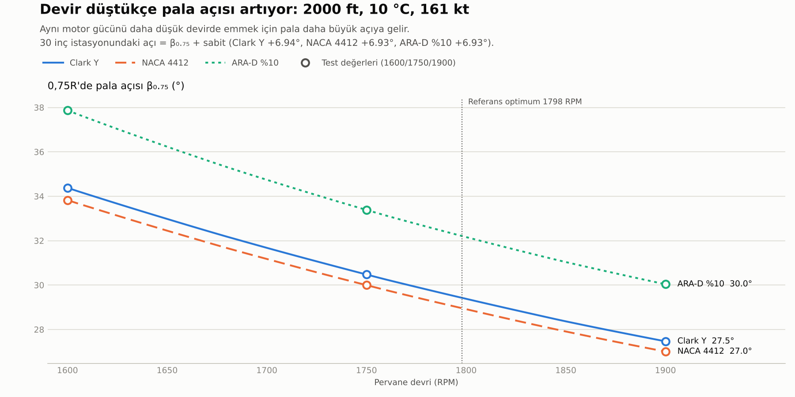
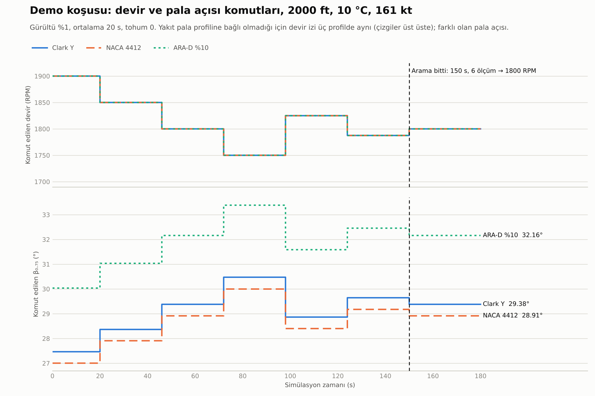

# Adım 8: Bulunan devirden pala açısı ve Arduino bağlantısı

Bu rapor, perturb & observe (P&O) algoritmasının her adımda denediği devir için pala açısının nasıl
hesaplandığını ve bu açının prototipteki servoya nasıl gönderildiğini özetler.
Kod: `pala_acisi.py`, `pala_algoritma.py`, `seri_port.py`, `arduino/pala_servo/pala_servo.ino`,
`analiz/demo_pala.py`, `analiz/adim8.py`. Çıktılar: `sonuclar/adim8_*`.

## Kısa cevap

- **Pala açısı, devir düştükçe artıyor.** 2000 ft, 10 °C, 161 kt'ta 1900 → 1600 RPM'de β₀.₇₅:
  - Clark Y: 27,46° → 34,38°
  - NACA 4412: 27,00° → 33,82°
  - ARA-D %10: 30,04° → 37,87°

  Verilen dokuz test değerinin hepsi ±0,05° içinde tuttu (tolerans ±0,3°).
- **Bütün zarfta açı aralığı dar ve servonun sınırları içinde.** 392 koşul × 3 profil × 2 devirde
  (referans optimum ve 1900 RPM) β₀.₇₅ 22,8° ile 35,7° arasında. Hiçbir noktada çözümsüz (NaN) sonuç
  çıkmadı; 15–50° sınırına hiç yaklaşılmadı.
- **Optimuma gitmek palayı ortalama 1–2° açtırıyor.** Optimumu 1900'ün altında olan koşullarda
  β₀.₇₅ farkı ortalama 1,7° (Clark Y, NACA 4412) ve 1,9° (ARA-D). En büyük fark 6,2–7,0°.
  Servo çözünürlüğü bu mertebeye göre seçilmeli.
- **Demo (kuru mod) üç profilde de çalıştı.** Arama 150 s ve 6 ölçüm sürdü, 1800 RPM'de durdu.
  Sabit 1900 RPM'e göre kararlı tasarruf 2,56 PPH (%0,68). Pala açısı 1900'den 1800'e geçerken yaklaşık
  2° açıldı: Clark Y 29,38°, NACA 4412 28,91°, ARA-D 32,16°.
- **Önemli bir tutarsızlık bulundu (Sınırlamalar, 1. madde).** POH'un torkuyla haritalardan hesaplanan
  itki, devir düştükçe %2–4 azalıyor. Oysa aynı hızda düz uçuşta itki sabit kalmalı. Yani haritalar ile
  POH birbirini tam doğrulamıyor. Açının kendisi doğru tanıma göre hesaplanıyor, ama bu fark açıyı
  yorumlarken akılda tutulmalı.

## 1. Yöntem

### 1.1 Regülatör mantığı

Gerçek uçakta sabit hızlı pervanenin regülatörü, motorun verdiği gücü seçilen devirde emecek pala açısını
bulur. Burada da aynı mantık kullanıldı:

1. **Güç**, test dünyasının (`sanal_ucak`) o devirdeki torkundan bulunur:
   P [W] = devir × tork [ft-lb] / 5252 × 745,7
2. **Yoğunluk:** Basınç ISA'dan (basınç irtifası), sıcaklık gerçek değerden alınır:
   - h = irtifa × 0,3048
   - T_ISA = 288,15 − 0,0065·h
   - p = 101325·(T_ISA/288,15)^5,25588
   - ρ = p / (287,05·(T + 273,15))
3. **Boyutsuz büyüklükler:** V = hız × 0,5144, n = devir/60, D = 2,69 m
   - J = V/(nD)
   - C_P,gerekli = P/(ρ n³ D⁵)
4. **Açı:** Haritada C_P(J, β₀.₇₅) = C_P,gerekli denklemi çözülür.
5. **30 inç açısı:** POH pala açısını 30 inç istasyonunda verdiği için açı oraya da taşınır:
   β_30inç = β₀.₇₅ + θ(0,762 m) − θ(0,75 × 1,345 m)

   θ(r), geometri dosyasındaki tasarım açı dağılımının r'ye göre doğrusal ara değeridir. Fark üç profilde
   de neredeyse aynı: Clark Y +6,94°, NACA 4412 +6,93°, ARA-D +6,93°.
6. **Ek çıktılar:**
   - İtki = C_T·ρ n² D⁴
   - Verim = J·C_T/C_P

### 1.2 Harita ve kök bulma

- Haritalar düzenli bir ızgara: J 0,50–1,70 (0,05 aralık), β₀.₇₅ 15–50° (1° aralık).
  - C_T ve C_P çift doğrusal interpolasyonla okunuyor.
  - Izgara dışında ekstrapolasyon yapılmıyor, NaN dönüyor.
  - Her profil bir kez okunup önbellekte tutuluyor.
- **Düşük J ve yüksek β bölgesinde C_P, β ile tekdüze artmıyor (stall).**
  - Örnek: ARA-D'de J = 0,5'te C_P 31°'de 0,0725'ten 36°'de 0,0703'e düşüyor, sonra yeniden artıyor.
  - Bu yüzden kök aramasında 15°'den yukarı doğru 0,01°'lik tarama yapılıyor ve **ilk kesişim**
    alınıyor. Fiziksel olarak bu, regülatörün düşük açıdan gelirken ulaştığı açıdır.
  - Kesişim bulunan aralık ikiye bölmeyle 10⁻⁶°'ye kadar daraltılıyor.
  - Kesişim yoksa NaN dönüyor.
  - Tarama vektörel yapılıyor: önce her β düğümünde J yönünde, sonra β yönünde doğrusal ara değer.
    Bu, çift doğrusal interpolasyonun kendisi.
- Bu zarfta J 0,89–1,10, C_P 0,068–0,114 aralığında kaldı. Stall bölgesine hiç girilmedi; ilk kesişim
  kuralı bu koşullarda sonucu değiştirmiyor ama prototipte farklı koşullar için güvence.

### 1.3 Algoritmaya bağlantı

`algoritma.py` değişmedi. `pala_algoritma.pala_perturb_observe`, algoritmaya verilen `olc(devir)`
fonksiyonunu sarıyor. Her ölçümde sırası şöyle:

1. Denenen devrin pala açısını hesapla.
2. Açıyı komut fonksiyonuna gönder (ör. `PalaKomutu.gonder`). Prototipte de önce pala döner, devir oturur.
3. Asıl ölçümü yap.

Geçmiş tablosunun her satırında şu sütunlar var: devir, yakıt, kabul, neden, beta75, beta_30inc.
Gerçekçi ölçümde bunlara komut ve ölçüm zamanı da ekleniyor. Bulunan devir ve o devirdeki açı
ayrıca veriliyor.

Kabul/ret kararı algoritmanın içinde verildiği için `olc()`'dan görünmüyor. Demo bu kararı her adımda
canlı yazabilsin diye karar, algoritmanın kuralıyla (yeni yakıt < kabul edilen yakıt − eşik) sarmalayıcıda
tekrar hesaplanıyor. Koşu bitince bu karar algoritmanın kendi geçmişiyle karşılaştırılıyor; uyuşmazsa hata
veriliyor. Algoritmanın "limit" adımlarında (`olc()` çağrılmadan reddedilen adımlar) servoya komut
gitmiyor, ama açı geçmiş tablosunda yine gösteriliyor.

### 1.4 Arduino bağlantısı

`seri_port.PalaKomutu`:

| Özellik | Davranış |
|---|---|
| Mesaj | `"B 30.50\n"`: 0,75R açısı, 2 ondalık, nokta ile |
| Sınırlar | Varsayılan 15–50°. Dışındaki açı kırpılır ve uyarı yazılır. NaN açı gönderilmez, uyarı yazılır |
| Hız sınırı | En fazla `max_hz` (varsayılan 10) mesaj/s. Erken gelen komut düşürülmez, sırası gelene kadar beklenir (servo için son komut önemli) |
| Cevap | Arduino'nun `"OK <açı>"` cevabı tamponda varsa okunur ve kaydedilir. Cevap beklenmez (port `timeout=0`) |
| Kuru mod | `port=None`: donanım açılmaz, mesajlar listeye ve konsola yazılır. pyserial yalnızca port verilince import edilir |
| Açılış | Çoğu Arduino port açılınca yeniden başlar. Bu yüzden açılışta 2 s beklenir (`acilis_bekleme_s`) |

`arduino/pala_servo/pala_servo.ino` (taslak):

- `"B <açı>"` satırını okur, açıyı 15–50°'ye kırpar.
- Açıyı kalibrasyon tablosuyla (`pala_acisi[]`, `servo_acisi[]`) parça parça doğrusal olarak servo
  açısına çevirir.
- Servoyu `writeMicroseconds` ile sürer; böylece kesirli derece çözünürlüğü elde edilir.
- `"OK <açı>"` döner. Anlaşılmayan satıra `"ERR ..."` döner.
- Servo pini (9) ve açı sınırları dosyanın başında sabit olarak tanımlı.
- **Kalibrasyon tablosu doğrusal bir yer tutucu** (15–50° → 20–160° servo) ve yorumla işaretli.
  Ekip arkadaşının prototipte ölçmesi gerekiyor.
- Dosyanın başında açının 0,75R kesitinde (r ≈ 1,009 m) ölçülmesi gerektiği yazıyor.

Arduino taslağı bu ortamda derlenmedi; donanımla ilk denemede derleyici çıktısına bakılmalı.

## 2. Varsayımlar

| Varsayım | Değer | Not |
|---|---|---|
| Pervane | 2,69 m çap, 3 pala, BEMT haritası | Temsili pervane (bkz. Sınırlamalar) |
| Güç | POH torku × devir; pervanenin emdiği güç = motor şaft gücü | Dişli/aksesuar kaybı yok |
| Basınç | ISA, basınç irtifası = tablo irtifası | |
| Sıcaklık | Tablodaki gerçek dış hava sıcaklığı | |
| Hız | Tablodaki hız gerçek hava hızı (KTAS) kabul edildi | |
| Referans istasyon | 0,75R = 1,00875 m; POH istasyonu 30 inç = 0,762 m | |
| Demo ölçümü | %1 gürültü, 20 s ortalama, tau = 2 s, 6 s bekleme, tohum 0 | Adım 7'de seçilen ayar |
| Servo | Komut anında uygulanıyor kabul edildi | Servo ve pala dinamiği modellenmedi |

## 3. Sonuçlar

### 3.1 Test koşulu: 2000 ft, 10 °C, 161 kt

| Profil | Devir | β₀.₇₅ (beklenen) | β₀.₇₅ (hesap) | β 30 inç | İtki (N) | Verim |
|---|---:|---:|---:|---:|---:|---:|
| Clark Y | 1900 | 27,5 | 27,46 | 34,40 | 4242 | 0,868 |
| | 1750 | 30,5 | 30,47 | 37,41 | 4125 | 0,859 |
| | 1600 | 34,4 | 34,38 | 41,31 | 4100 | 0,844 |
| NACA 4412 | 1900 | 27,0 | 27,00 | 33,94 | 4236 | 0,867 |
| | 1750 | 30,0 | 30,00 | 36,93 | 4118 | 0,858 |
| | 1600 | 33,8 | 33,82 | 40,76 | 4089 | 0,841 |
| ARA-D %10 | 1900 | 30,0 | 30,04 | 36,97 | 4228 | 0,865 |
| | 1750 | 33,4 | 33,38 | 40,32 | 4102 | 0,855 |
| | 1600 | 37,9 | 37,87 | 44,80 | 4060 | 0,836 |

Gerekli C_P: 1900'de 0,0781, 1750'de 0,0981, 1600'de 0,1300.



- Clark Y ile NACA 4412 birbirine çok yakın (yaklaşık 0,5° fark).
- ARA-D %10 aynı gücü emmek için Clark Y'den 2,6° (1900 RPM) ile 3,5° (1600 RPM) daha büyük açı istiyor.
- Eğriler 1600–1900 aralığında neredeyse doğrusal: 100 RPM başına yaklaşık 2,3° (Clark Y, NACA 4412)
  ve 2,6° (ARA-D).

### 3.2 Bütün zarf: `sonuclar/adim8_pala_acisi.csv`

Adım 5'in 392 koşulu × 3 profil = 1176 satır. Her satırda:

- Referans optimum devirde ve 1900 RPM'de β₀.₇₅
- İkisi arasındaki fark
- 30 inç açıları
- Referans devirde J ve C_P
- İki devirdeki verim

| Profil | β₀.₇₅, referans devir | β₀.₇₅, 1900 RPM | Δβ ortalama (optimum < 1900 olan koşullar) | Δβ en büyük |
|---|---|---|---:|---:|
| Clark Y | 25,7–32,4° | 23,3–32,4° | 1,68° | 6,21° |
| NACA 4412 | 25,2–31,9° | 22,8–31,9° | 1,68° | 6,21° |
| ARA-D %10 | 28,1–35,7° | 25,4–35,7° | 1,88° | 6,96° |

- Hiçbir satırda kesişim bulunamama (NaN) durumu yok.
- Referans optimumu 1900'de olan 177 koşulda iki açı aynı.

### 3.3 Demo koşusu

`python analiz/demo_pala.py --profil <profil>` (kuru mod, hız çarpanı 10, tohum 0). Clark Y çıktısı:

```
    Zaman        Devir  Ölçülen yakıt  Karar  Pala açısı
  [kuru] -> B 27.46
   20.0 s   1900.0 RPM    374.06 PPH  kabul  β75  27.46°  (30 inç: 34.40°)  [başlangıç]
  [kuru] -> B 28.37
   46.0 s   1850.0 RPM    372.03 PPH  kabul  β75  28.37°  (30 inç: 35.30°)  [daha iyi]
  [kuru] -> B 29.38
   72.0 s   1800.0 RPM    371.39 PPH  kabul  β75  29.38°  (30 inç: 36.32°)  [daha iyi]
  [kuru] -> B 30.47
   98.0 s   1750.0 RPM    371.48 PPH  ret    β75  30.47°  (30 inç: 37.41°)  [daha kötü]
  [kuru] -> B 28.86
  124.0 s   1825.0 RPM    371.69 PPH  ret    β75  28.86°  (30 inç: 35.80°)  [daha kötü]
  [kuru] -> B 29.64
  150.0 s   1787.5 RPM    371.80 PPH  ret    β75  29.64°  (30 inç: 36.58°)  [daha kötü]
  [kuru] -> B 29.38
```

Son satırdaki komut, aramanın sonunda bulunan devre (1800 RPM) dönüş için gönderiliyor.

| Profil | Bulunan devir | β₀.₇₅ | β 30 inç | 1900'de β₀.₇₅ | Tasarruf (kararlı) | Komut sayısı |
|---|---:|---:|---:|---:|---:|---:|
| Clark Y | 1800 | 29,38° | 36,32° | 27,46° | 2,56 PPH (%0,68) | 7 |
| NACA 4412 | 1800 | 28,91° | 35,85° | 27,00° | 2,56 PPH (%0,68) | 7 |
| ARA-D %10 | 1800 | 32,16° | 39,09° | 30,04° | 2,56 PPH (%0,68) | 7 |

- Tasarruf, bulunan devirdeki gerçek (gürültüsüz) yakıt ile sabit 1900'deki yakıt arasındaki fark.
  Arama maliyeti dahil değil.
- Referans optimum 1798 RPM. Algoritma 1800'de durdu.
- Test dünyasında yakıt pala profiline bağlı değil. Bu yüzden aynı tohumla devir izi ve tasarruf üç
  profilde birebir aynı; farklı olan yalnızca pala açısı.



## 4. Sınırlamalar

1. **Haritalar ile POH tam tutarlı değil.**
   - POH'a göre 161 kt'ı tutmak için gereken güç 1900'de 543 hp, 1800'de 534 hp, 1750'de 533 hp.
     Yani düşük devirde daha az güç yetiyor; bu da düşük devirde pervanenin daha verimli olduğu anlamına
     gelir.
   - Haritalara göre ise verim devir düştükçe azalıyor (Clark Y: 1900'de 0,868, 1750'de 0,859).
   - Sonuç olarak hesaplanan itki 1900'den 1750'ye %2,8, 1600'e %3,3 düşüyor. Oysa aynı hızda düz
     uçuşta itki, sürüklemeye eşit ve sabit olmalı.
   - Zarfta optimumu 1900'ün altında olan 215 koşulun 214–215'inde, referans devirdeki harita verimi
     1900'dekinden düşük.
   - Açı, görevde tanımlandığı gibi "motor gücünü emen açı" olarak hesaplandı ve bu tanıma göre doğru.
     Ama "itkiyi sabit tutan açı" ile aynı değil. Fark, temsili pervanenin gerçek McCauley pervanesinden
     farklı olmasından ve POH'taki yakıt farklarının bir kısmının motor tarafından gelmesinden
     kaynaklanıyor olabilir. Bu adımda düzeltme yapılmadı.
2. **Mach etkisi yaklaşık.** Haritalar, dalga sürüklemesi için 1900 RPM'deki ses hızı referans alınarak
   üretildi. Başka devirlerde Mach etkisi yaklaşık.
3. **Haritalardaki pervaneler Caravan'ın gerçek McCauley pervanesi değil.** Aynı çap ve pala sayısıyla
   tasarlanmış temsili pervaneler. Bu yüzden açıların mutlak değerleri gerçek uçağın POH açılarıyla
   doğrudan karşılaştırılmamalı. Devirle değişim eğilimi daha anlamlı.
4. **Profil verileri NeuralFoil'den, pürüzsüz yüzey varsayımıyla.** Sürükleme iyimser. Gerçek (pürüzlü,
   kirli) palada aynı gücü emmek için gereken açı biraz farklı olur.
5. **Güç, POH torkundan.** Pervanenin emdiği güç motor şaft gücüne eşit alındı; dişli kutusu ve
   aksesuar kayıpları ihmal edildi.
6. **Hava modeli:** Basınç ISA'dan, sıcaklık tablodan. Tablodaki hız gerçek hava hızı (KTAS) kabul edildi.
7. **Dinamik yok.** Pala açısının servoyla değişmesi ve devrin buna tepkisi modellenmedi. Simülasyonda
   devir komutu motor gecikmesiyle (tau = 2 s), pala açısı ise anında değişiyor. Prototipte asıl kontrol
   değişkeni pala açısı olacak; devir, açının sonucu olacak.
8. **Kalibrasyon tablosu yer tutucu.** Arduino taslağındaki pala–servo tablosu doğrusal bir varsayım ve
   derlenmedi. Prototipte ölçülmeli.
9. **Demo tek koşul, tek tohum.** Zarf boyunca demo koşusu yapılmadı. Açı tablosu ise bütün zarfı
   kapsıyor.

## 5. Testler ve yeniden üretim

- `testler/test_pala.py` yeni test dosyası (78 test):
  - Dokuz β₀.₇₅ değeri ±0,3° içinde (hepsi ±0,05° içinde çıktı).
  - Devir 1900'den 1600'e 10 RPM adımla düşerken üç profilde de β₀.₇₅ kesin artıyor.
  - Bulunan açıyla haritadan geri hesaplanan C_P, gerekli C_P'ye %0,5 içinde eşit (4 koşul × 4 devir ×
    3 profil).
  - Çift doğrusal interpolasyon ızgara düğümlerinde tablo değerini veriyor.
  - Tekdüze olmayan bölgede ilk kesişim seçiliyor (ARA-D, J = 0,5). Kesişim yoksa ya da J harita
    dışındaysa NaN dönüyor.
  - Sarmalayıcı algoritmanın sonucunu değiştirmiyor; her ölçümden önce bir komut gönderiyor; "limit"
    adımları tabloda; gürültülü ölçümde canlı kabul kararı algoritmayla uyuşuyor (5 tohum).
  - Kuru moddaki `PalaKomutu`: mesaj biçimi, kırpma ve uyarı, NaN'ın gönderilmemesi, 10 Hz hız sınırı
    (6 mesaj ≥ 0,5 s, hiçbiri düşürülmüyor).
- `python -m pytest`: 111 testin 110'u geçti. Kalan 1 başarısızlık eski bir yavaş test ve bu adımla ilgili
  değil:
  - Test: `test_olcum.py::test_gurultusuz_ve_gecikmesiz_adim5_ile_ayni`
  - Koşul: 2000 ft, −30 °C, 152 kt.
  - Bu koşulda 1700 ve 1725 RPM'deki yakıt matematiksel olarak eşit (355,4444 PPH). Hangisinin
    "daha düşük" sayılacağına son ondalıktaki kayan nokta yuvarlaması karar veriyor.
  - Bu ortamdaki numpy 2.5 / pandas 3.0, `zarf_sonuclari.csv`'nin üretildiği ortamdan farklı yuvarlıyor:
    algoritma 1712,5 yerine 1700'de duruyor.
  - Test ve dosyalar değiştirilmedi.
- `python analiz/adim8.py`: CSV'yi ve iki grafiği üretir (yaklaşık 15 s).
- `python analiz/demo_pala.py --profil clarky|naca4412|arad10 [--port COM5] [--hiz-carpani 10]`: demo.
  `--hiz-carpani 0` beklemeden çalıştırır.
